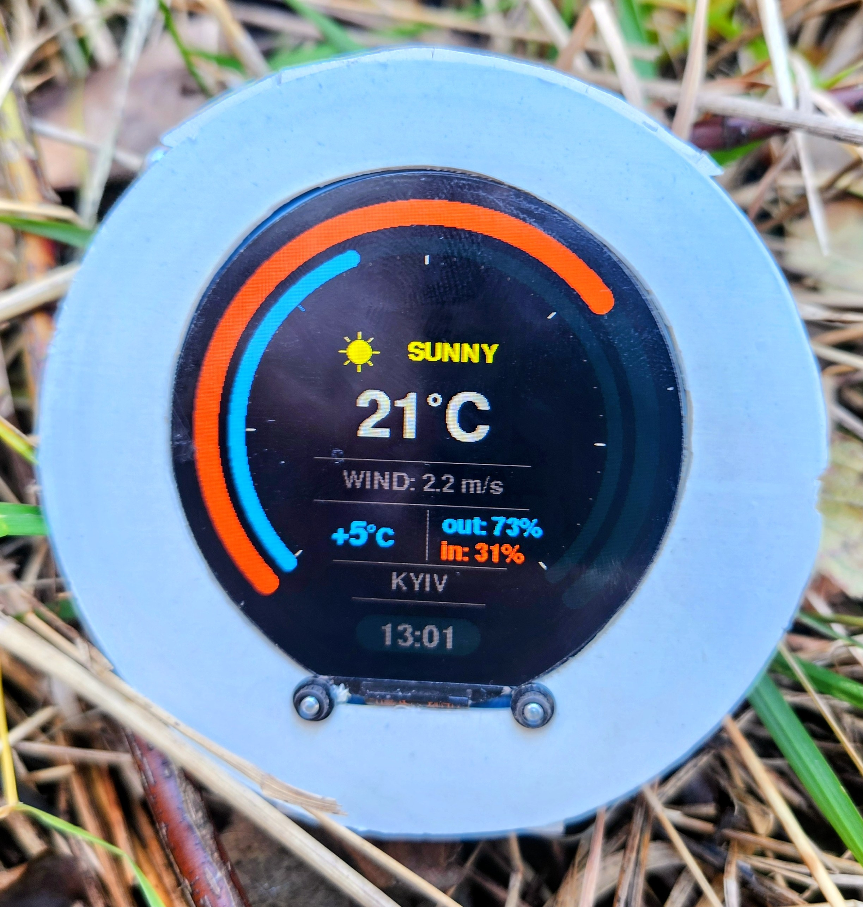
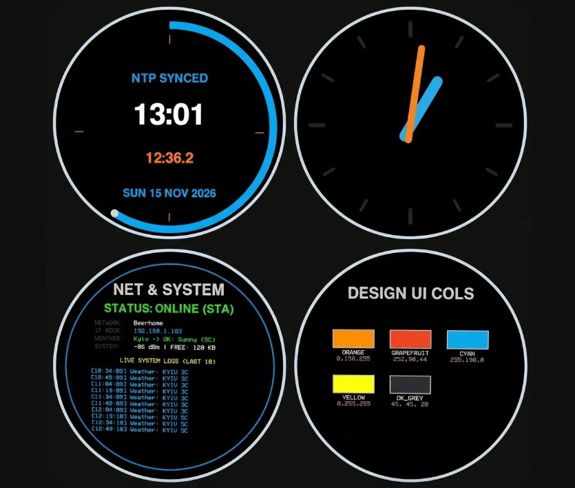
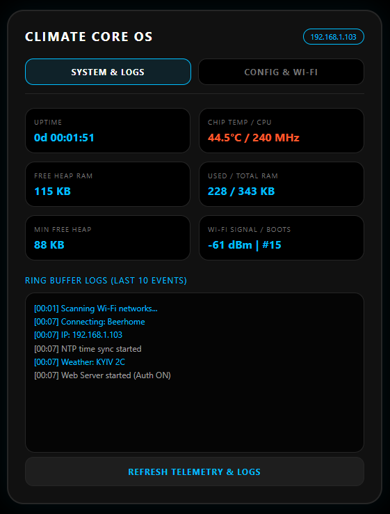
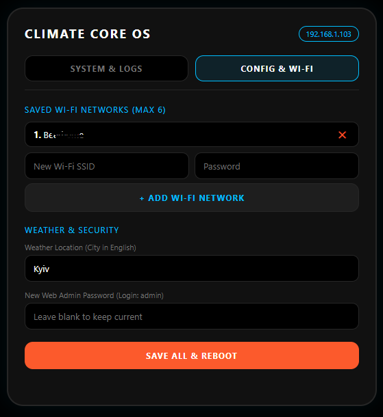

# ⌚ ESP32-S3 Round Climate & Chronograph Core OS

A sleek, high-frame-rate graphical telemetry station and chronometer engineered for the **ESP32-S3** microcontroller and a **360×360 round IPS display (GC9B72)**. Built on a custom modular C++ architecture using **LovyanGFX** and **asymmetric dual-core FreeRTOS**, this project demonstrates how **cost-effective, accessible hardware components** (such as a PSRAM-less ESP32-S3 board) can achieve deterministic **60 FPS** throughput and an optimal **price-to-performance ratio**. Designed initially as a **DIY prototype**, its thread-safe codebase and deterministic memory model are structured as a reusable blueprint for **industrial scaling and mass production**.

---

## 📸 Hardware & UI Gallery

<table>
  <tr>
    <td align="center" width="50%">
      <b>Device & Main Dashboard</b><br>
      
    </td>
    <td align="center" width="50%">
      <b>Additional UI Screens</b><br>
      
    </td>
  </tr>
  <tr>
    <td align="center" width="50%">
      <b>Web Admin (System & Logs)</b><br>
      
    </td>
    <td align="center" width="50%">
      <b>Web Admin (Configuration & Wi-Fi)</b><br>
      
    </td>
  </tr>
</table>

---

## 🎨 Visual Design & UI Philosophy

Designed specifically for circular displays, the interface eliminates rectangular clutter in favor of radial symmetry, high-contrast typography, and hardware-calibrated color semantics:

* **Dual-Arc Climate Dashboard (Screen 1):**
  * **Outer Grapefruit Arc (`#FC5A2C`):** Real-time indoor sensor temperature (`-20°C` to `+40°C`) with smooth 60 FPS cubic-ease interpolation.
  * **Inner Cyan Arc (`#00BEFF`):** Live localized outdoor temperature with dynamic thermal color shifting (Ice Blue, Cyan, Lime, Grapefruit, Red).
  * **Context-Aware Vector Weather Engine:** Automatically renders 7 distinct meteorological states (`Clear`, `Partly Cloudy`, `Cloudy`, `Rain`, `Snow`, `Storm`, `Fog`) and switches between daytime solar rays and nighttime crescent moon/stars based on local RTC/NTP time.
  * **Capsule Badge Footer:** Features live wind speed (`m/s`), dual humidity telemetry, location banner, and a digital clock nestled inside a dark graphite pill echoing the arc end-caps.
* **Minimalist Capsule Analog Watch (Screen 2):** Pure horological layout with 12 dark-graphite index ticks and rounded pill-shaped hands (`16px` Cyan hour hand, `10px` Grapefruit minute hand) matching the exact stroke weights of the primary climate gauges.
* **Precision Digital Chronograph (Screen 3):** Sub-second 60 FPS sweeping outer progress ring driven by hardware `gettimeofday()` microsecond registers, paired with an uptime stopwatch.
* **Live System & Network Console (Screen 4):** Real-time Wi-Fi diagnostics, signal strength (`RSSI`), free heap monitor, and a 10-line color-coded ring-buffer event log.
* **Hardware Color Calibration Grids (Screens 5 & 6):** Diagnostic swatches engineered to compensate for IPS panel gamma and 8-bit color quantization.
* **Smart Lamp Link Telemetry (Screen 7):** Live synchronization status, brightness arc easing, and presence auto-off countdown for the **Ridy-10-Lite** desk lamp.

---

## ⚡ Engineering Research & Performance Optimization

Delivering a 360×360 graphical UI alongside an asynchronous web server, HTTP weather client, OTA updates, and smart-home device control on an **ESP32-S3 without external PSRAM** (338 KB internal SRAM) required rigorous architectural optimization:

1. **Graphics Engine Selection (LovyanGFX vs. LVGL):**
   * *Analysis:* Following our architectural benchmark ([see detailed comparison in HowToChooseGlib.md](https://github.com)), we migrated from heavy object-oriented **LVGL** to the low-level hardware-accelerated **LovyanGFX** driver. This eliminated partial dirty-zone stride artifacts on round matrices, cut RAM overhead drastically, and unlocked native sub-pixel anti-aliased arcs via direct ESP32-S3 DMA flushing.
2. **8-Bit RGB332 Full-Screen Sprite Architecture (~50% RAM Reduction):**
   * *Challenge:* A standard 16-bit (`RGB565`) full-screen buffer requires `259.2 KB` of contiguous SRAM, starving the Wi-Fi stack and causing `Out of Memory` panics.
   * *Solution:* Allocated the 360×360 LovyanGFX sprite in **8-bit (`RGB332`)** **before** Wi-Fi initialization, cutting framebuffer allocation to **`129.6 KB`** with zero heap fragmentation while maintaining flicker-free **60 FPS** rendering.
3. **8-Bit Color Quantization & Gamma Calibration:**
   * *Research:* In `RGB332` space, the blue channel is limited to 2 bits (`85`-unit steps), causing neutral dark greys (e.g., `52, 52, 52`) to exhibit a noticeable blue tint on IPS panels.
   * *Resolution:* Mathematically calibrated the `dark_graphite` constant to **`RGB(45, 45, 20)`**, zeroing out the parasitic blue bit to achieve a crisp, warm charcoal tone across all UI tracks and watch indices.
4. **Sub-Second Phase-Locked Rendering:**
   * *Challenge:* Combining `localtime()` seconds with `millis() % 1000` introduced phase drift, causing visual micro-stutters on the chronograph ring.
   * *Resolution:* Replaced polling calls with direct hardware RTC reads via `gettimeofday(&tv, NULL)`, synchronizing seconds and microseconds from a single clock domain.
5. **Asymmetric Dual-Core FreeRTOS Architecture (`Core 0` vs. `Core 1`):**
   * **Core 1 (Real-Time UI & Peripherals):** Dedicated exclusively to deterministic 60 FPS frame interpolation (`16 ms` budget), SPI DMA sprite flushing, `HLK-LD2410` radar state machine, debounced button input, and non-blocking sensor polling. Zero blocking network calls execute on Core 1.
   * **Core 0 (Unified Protocol & Network Worker):** Runs the ESP-IDF Wi-Fi/LwIP stack alongside a single consolidated `NetWorkerTask` (`6144 bytes` stack, Priority `1`). All blocking or variable-latency tasks—Wi-Fi scanning/reconnection, HTTP weather polling, `Ridy-10-Lite` lamp link commands, and `ArduinoOTA.handle()`—execute asynchronously on Core 0. Consolidating network and lamp polling into a single worker thread saved **~6 KB of contiguous SRAM**.
6. **Zero-Heap Critical Sections & Lock-Free Cross-Core UI Bridge:**
   * **Spinlock Discipline (`portMUX_TYPE`):** Dynamic `String` allocations and `Serial` I/O are strictly forbidden inside `portENTER_CRITICAL()` blocks to prevent cache/heap panics. Timestamps are formatted on the stack via `snprintf()`, and ring-buffer shifts use zero-copy `std::move()`.
   * **Dirty-Flag UI Synchronization:** Core 0 never touches the SPI display bus directly. `UIManager::setOutdoorData()` updates fixed-size stack `char` arrays under a spinlock and raises `_outdoor_dirty`, which Core 1 consumes cleanly on the next 60 FPS render pass.
   * **Deferred Eco-Mode Transitions:** Radar-triggered Wi-Fi sleep/wake transitions post non-blocking flags (`_eco_dirty`) from Core 1 to Core 0, ensuring screen wake-up is instantaneous (`<16 ms`).

---

## 📊 Verified Memory & Performance Telemetry

| Metric | Single-Core Baseline | Dual-Core (2 Separate Tasks) | Dual-Core (Unified Core 0 Worker) |
| :--- | :---: | :---: | :---: |
| **Total Internal SRAM** | 338 KB | 338 KB | **338 KB** |
| **Free Heap RAM (Runtime)** | 91 KB | 81 KB | **89 KB** |
| **Min Free Heap (Watermark)** | 58 KB | 49 KB | **56 KB** |
| **UI Frame Rate Under HTTP Load** | Micro-stutters | Smooth 60 FPS | **Locked 60 FPS** |
| **Presence → Screen/Lamp Trigger** | Blocked during weather sync | Instant (<50 ms) | **Instant (<50 ms)** |

---

## 🔒 Security, mDNS & Autonomous Web Control Panel

The device hosts an embedded, dark-themed **Climate Core OS** web dashboard (`ESPAsyncWebServer`) accessible via **`http://climate-station.local`** (`mDNS`) and styled to match the physical watch UI:

* **HTTP Basic Authentication & Wireless OTA:** All HTML routes, JSON REST endpoints (`/api/telemetry`, `/api/config`, `/api/save`), and Over-The-Air firmware updates (**ArduinoOTA** via `climate-station.local`) are protected behind NVS-persisted admin credentials.
* **Multi-AP Roaming (Up to 6 Wi-Fi Networks):** On boot, the controller scans the RF spectrum (`WiFi.scanNetworks()`), matches available BSSIDs against 6 stored credential slots, and automatically connects to the strongest signal. Falls back to `ClimateStation-AP` (`192.168.4.1`) if offline.
* **Full Runtime Provisioning:** Configure Wi-Fi credentials, weather city, radar & display sleep delays (`screen_delay`), Eco Wi-Fi mode, Ridy-10-Lite lamp endpoint/API key/auto-off timer, and admin password directly from the browser.
* **Live Hardware Telemetry & Spinlock Ring-Buffer Logger:**
  * Tracks uptime, free/used heap RAM, minimum free heap watermark (`ESP.getMinFreeHeap()`), CPU clock (`240 MHz` active / `80 MHz` eco), internal silicon temperature (`temperatureRead()`), RSSI, and boot counter.
  * Thread-safe 10-entry `SysLogger` ring buffer mirrors critical system events simultaneously to the round display, Serial console, and Web UI without heap fragmentation.

---

## 📂 Modular Project Structure

```text
ESP32S3DevRound/
├── platformio.ini              # Build environments (USB & ArduinoOTA), LovyanGFX, AsyncWebServer
├── HowToChooseGlib.md          # Architectural comparison: LVGL vs. LovyanGFX on round IPS
└── src/
    ├── main.cpp                # Core 1 real-time loop (radar, button debounce, sensors, 60 FPS UI)
    ├── config/
    │   ├── config.h            # GPIO pinout definitions and default timing constants
    │   └── app_config.h/cpp    # NVS (Preferences) persistent settings manager
    ├── display/
    │   ├── display_lgfx.h      # Custom LovyanGFX SPI bus driver for GC9B72 (360x360)
Будьте обачні, використовуючи код.
│   ├── display_colors.h/cpp# 8-bit calibrated color palette & BRG/RGB mapping
│   ├── ui_manager.h/cpp    # Thread-safe 60 FPS animation state machine & sprite dispatcher
│   └── screens/            # Isolated screen rendering modules (Weather, Clocks, Net, Lamp)
├── network/
│   ├── net_manager.h/cpp   # Core 0 NetWorkerTask, 6-AP Wi-Fi, mDNS, NTP, Eco-WiFi & OTA
│   ├── weather_client.h/cpp# Lightweight HTTP weather fetcher & parser
│   ├── lamp_client.h/cpp   # Core 0 Ridy-10-Lite smart lamp automation & status sync
│   ├── web_server.h/cpp    # AsyncWebServer routes, Basic Auth & JSON REST API
│   └── web_*.h             # Embedded PROGMEM HTML, dark-graphite CSS & vanilla JS client
├── peripherals/
│   ├── sensor_dht.h/cpp    # Indoor climate sensor polling (upgrading to I2C SHT31 + BH1750)
│   └── radar_ld2410.h/cpp  # HLK-LD2410 presence detection & dynamic CPU/display power-save
└── system/
└── sys_logger.h/cpp    # Spinlock-protected 10-line ring-buffer diagnostic logger
```

🛠 Hardware & Tech Stack

• MCU: ESP32-S3 (Xtensa LX7 Dual-Core @ 240 MHz, 338 KB SRAM, No PSRAM — optimized BOM cost)
• Display: 360×360 Round IPS LCD (GC9B72 SPI Controller)
• Sensors & Input: Climate Sensor (upgrading to I2C SHT31 + BH1750), Tactile Navigation Button (GPIO 18, INPUT_PULLUP), Presence Radar HLK-LD2410 (GPIO 6)
• Framework: Arduino / Espressif32 via PlatformIO

🗺️ Master Upgrade Roadmap


✅ Phase 1: Dual-Core FreeRTOS Foundation & Thread Safety (Completed)

• Step 1.1 — Thread-Safe Ring Logger (sys_logger.h/cpp): Added portMUX_TYPE spinlocks, stack-based snprintf timestamps, and std::move buffer rotation.
• Step 1.2 — Cross-Core UI Data Guard (ui_manager.h/cpp): Isolated Core 0 weather updates from Core 1 SPI flushing via _outdoor_dirty flag and fixed-size char buffers.
• Step 1.3 — Unified Core 0 Network Worker (net_manager.h/cpp, lamp_client.h): Consolidated ArduinoOTA, WeatherClient, LampClient, and deferred Eco-Mode Wi-Fi transitions into a single 6 KB task on Core 0.
• Step 1.4 — Live Radar Timeout Propagation (radar_ld2410.cpp): Fixed runtime application of configurable screenDelaySec grace period.

🚧 Phase 2: High-Precision I2C Sensor Suite & Smart Lux Automation (In Progress)

• Step 2.1 — Hardware & Build Config (config.h, platformio.ini): Replace DHT11 with shared I2C bus (SDA / SCL) for SHT31 (0x44) and BH1750 (0x23).
• Step 2.2 — Non-Blocking I2C Driver (sensor_climate.h/cpp): Periodic 2000 ms polling on Core 1 without blocking interrupts.
• Step 2.3 — Daylight-Aware Automation: Smooth PWM display backlight dimming based on ambient lux + configurable lux_threshold to inhibit lamp triggers during daytime.

⏳ Phase 3: Ultra-Fast ESP-NOW Wireless Link (Station ↔ Ridy-10-Lite)

• Step 3.1 — Packed Binary Protocol (espnow_protocol.h): 12-byte packed struct (magic, cmd, state, brightness, lux, security_token).
• Step 3.2 — Station ESP-NOW Transmitter (espnow_link.h/cpp): Channel-locked WIFI_STA + ESP-NOW queue on Core 0 (<10 ms latency, router-independent, zero HTTP heap overhead) + Web UI provisioning (cfg_lamp_mac, lux_threshold).
• Step 3.3 — Lamp Receiver Integration (Ridy-10-Lite): Direct esp_now_register_recv_cb packet handler.
